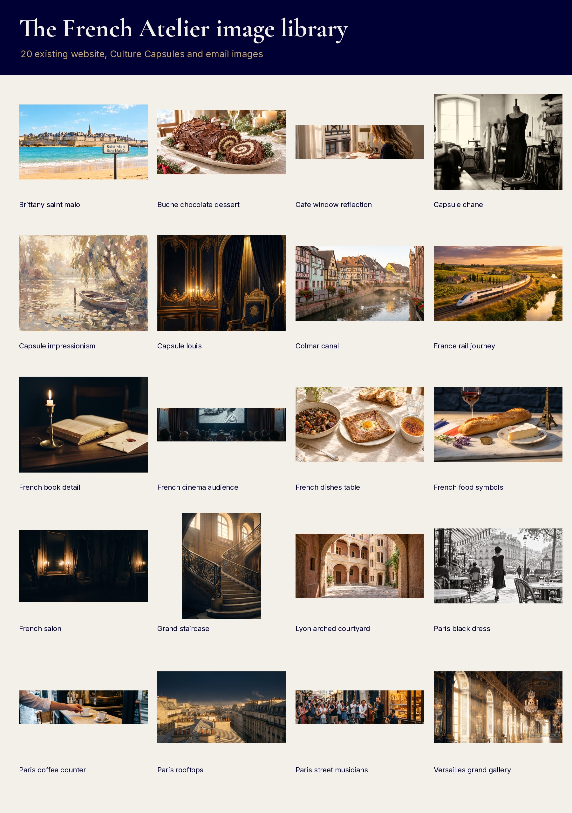

# French Atelier App Handoff

Prepared for Shemi. Brand assets, recovered original media and proposed product/store decisions are organised below.

This package brings together the existing French Atelier identity, curated website and email imagery, newly prepared app graphics, Julien's recovered media, and proposed store copy. Existing assets, new adaptations, proposals and unresolved requirements are identified separately.


## Brand basics

### Core colour palette

Use this small core palette for the app. Do not import colour variations from older email templates.

| Role | Colour | Exact hex | Application |
|---|---|---|---|
| Primary | Deep navy | `#000034` | Navigation, primary controls, dark surfaces |
| Signature accent | Gold | `#C8A96B` | Brand mark, primary highlights and key controls |
| Light surface | Warm ivory | `#F3EFE9` | Main light content surface |
| Dark/text | Deep navy | `#000034` | Body text and headings on light surfaces |
| Background | Warm ivory / white | `#F3EFE9` / `#FFFFFF` | Ivory for app surfaces; white for the requested launch screen |

These values follow the current website's explicit brand-deck-locked palette, rather than older email-template CSS ([French Atelier production design system](https://www.frenchatelierlive.com/css/fa.css)). This handoff groups them by practical app role instead of reproducing the entire website token list.

### Supporting colours

Deep navy and gold anchor the identity. Parisian pink, muted terracotta and the existing light-blue family support that identity; they do not replace gold or become the primary app theme.

| Supporting colour | Exact hex | Recommended use |
|---|---|---|
| Parisian pink | `#F3D3D9` | Supporting editorial details and soft surfaces |
| Muted terracotta | `#C76F50` | Supporting culture accents and headings |
| Light blue | `#BDD7F2` | Existing learning-platform card mid-tone |
| Pale blue | `#E8F1FB` | Light-blue surface / gradient start |
| Deeper light blue | `#8FB8E0` | Light-blue gradient end |
| Warm taupe | `#D8CAB5` | Supporting neutral panels and dividers |

The pink/terracotta values and the platform card's `#E8F1FB` → `#BDD7F2` → `#8FB8E0` gradient are present in the [current website stylesheet](https://www.frenchatelierlive.com/css/fa.css). Its Acadomia hero treatment also uses blue tint `#A7C9EB` and pale-blue text `#CFE1F5`; these are component-specific tints, not replacements for the core navy/gold identity.

### Typography

| Role | Font | Weights to use | Guidance |
|---|---|---|---|
| Primary brand/display | Cormorant Garamond | 500 and 600 for site-style titles; 700 reserved for the existing F mark | Titles, introductions and culture headlines |
| Supporting/body/UI | Inter | 400 body, 500 labels, 600 controls | Navigation, lessons, buttons, forms and longer text |

The current website declares Cormorant Garamond for display and Inter for UI/body ([website font declarations](https://www.frenchatelierlive.com/css/fa.css)). This handoff uses those verified website families with correctly declared variable-weight ranges; whether they are already bundled in Rosen/IIBS must be checked in that app's codebase, not assumed.

Recommended app type sizes: 28-36px display titles, 17-18px body and 14-16px labels. Preserve native accessibility text scaling and use Inter for dense learning interfaces.

### Brand imagery and language

**Visual direction:** Editorial French culture, warm natural light, architecture, cafés, food, fashion, art, music and regional places. Alternate expansive destinations with tactile close-ups; avoid generic classroom stock, repeated Eiffel Tower imagery and heavy decorative overlays.

**Writing direction:** Adult, warm, clear and useful. Connect a concrete French phrase with a recognisable moment, place or cultural detail; no promises of instant fluency.

The recovered examples come from the existing [French Atelier website](https://www.frenchatelierlive.com), [acquisition emails](https://gitteromri-ux.github.io/french-atelier-acq-drip/) and [email gallery](https://gitteromri-ux.github.io/french-atelier-emails-gallery/), with additional onboarding assets recovered directly from GitHub. The image library includes original files at their recovered dimensions; a large canvas or an existing filename is not treated as proof of native photographic resolution.

### Curated image library

Open [the visual library](assets/brand-library/CONTACT-SHEET.jpg) for a quick overview. The [image manifest](assets/brand-library/MANIFEST.md) gives each file's subject, dimensions and origin; the [library notes](assets/brand-library/README.md) explain selection and source limitations.

The library is organised around destinations, food, fashion, architecture, cinema and music. It contains existing work, not newly generated substitutes, and keeps panoramic email images separate from more flexible card images.



## App icons and launch screen

### Design decision for approval

Use the existing serif **F** mark for small app icons, in deep navy and gold. Use the full **French Atelier by Acadomia** wordmark on splash and login screens, where the name and endorsement can remain legible.

The icon is an adaptation of the existing email favicon, not a newly invented symbol. It is rendered afresh from the brand font rather than enlarged from the small favicon raster; the wordmark exports preserve existing logo pixels and their native detail.

| Deliverable | File | Verified specification |
|---|---|---|
| App icon | [app-icon-1024.png](assets/app/app-icon-1024.png) | 1024×1024 PNG, RGB, fully opaque, square corners |
| Android adaptive foreground | [android-adaptive-foreground-1024.png](assets/app/android-adaptive-foreground-1024.png) | 1024×1024 PNG, transparent; visible mark contained within the central 66% area |
| Android adaptive background | [android-adaptive-background-1024.png](assets/app/android-adaptive-background-1024.png) | 1024×1024 PNG, solid `#000034` |
| Splash image | [splash-1024.png](assets/app/splash-1024.png) | 1024×1024 PNG, transparent; navy wordmark for a white background |
| Android notification icon | [android-notification-96.png](assets/app/android-notification-96.png) | 96×96 PNG, white F silhouette on transparent |
| Login wordmark, light screens | [login-wordmark-navy.png](assets/app/login-wordmark-navy.png) | Transparent PNG, navy, cropped to the existing source artwork |
| Login wordmark, dark screens | [login-wordmark-white.png](assets/app/login-wordmark-white.png) | Transparent PNG, white, cropped to the existing source artwork |
| Google Play icon | [google-play-icon-512.png](assets/app/google-play-icon-512.png) | 512×512 PNG, RGB, opaque |
| Google Play feature graphic | [google-play-feature-1024x500.png](assets/app/google-play-feature-1024x500.png) | Exactly 1024×500 PNG |

The original gold and white wordmarks are 527px wide; the navy version is 541px wide. The splash uses the cropped source at native pixel size within the required 1024px canvas, without an enlargement pass.

Original navy, gold and white logo PNGs are also included in `assets/app/source-logo-*.png`. The app-sized F mark is the appropriate scalable choice for icons; do not enlarge the full raster wordmark for a large high-density hero.

## AI tutor: Julien

### Identity

**Name:** Julien. **Gender/presentation:** Male, using he/him language on the existing [Julien page](https://www.frenchatelierlive.com/juliane.html).

Use the established animated character with dark swept-back hair, a salt-and-pepper beard and navy clothing. Do not substitute the unrelated realistic man found in some older onboarding imagery.

### Media supplied

| Asset | Package location | What it is |
|---|---|---|
| Standing full-body artwork | [1800×2400 transparent PNG](assets/julien/stills/julien-full-body-1800x2400.png) | Exact 1800×2400 PNG; both legs and feet visible; cut out from the recovered original standing pose |
| Head-and-shoulders avatar | [640px transparent avatar](assets/julien/stills/julien-avatar-640.png) | Exact 640×640 transparent PNG; native-pixel crop from the recovered original standing artwork |
| Larger square avatar | [900px transparent avatar](assets/julien/stills/julien-head-shoulders-900.png) | 900×900 transparent PNG; native square crop from the cleaned upper-body still |
| Alternative upper-body still | [900px upper-body still](assets/julien/stills/julien-upper-body-transparent-900x1224-edge-clean.png) | 900×1224 upper-body image, separate from the full-body export |
| Transparent animated character | [julian-735.webm](assets/julien/originals/webm/julian-735.webm) | 900×1224 VP9 alpha, approximately 3.07 seconds, video only |
| Matching first frame | [Exact transparent first frame](assets/julien/stills/julien-alpha-first-frame.png) | Transparent first frame decoded directly from that WebM, unretouched |
| Existing talking master | [julien-hero-master.mp4](assets/julien/originals/mp4/julien-hero-master.mp4) | 800×1088, approximately 3.10 seconds, opaque background, embedded audio |
| Existing spoken introduction | [Julien French introduction](assets/julien/originals/audio/site/julien_intro_fr.mp3) | 15.291-second original audio; separate from the short motion clips |
| Recovered longer intro loop | [Original 15.366-second WebM](assets/julien/originals/recovered/julian-336-intro-loop.webm) | 900×1212, video only; preserved source file |
| Original uploaded videos | [Recovery notes](assets/julien/RECOVERY-NOTES.md) | Seven recovered original MP4 uploads, with exact native dimensions and durations |
| Master first-frame still | [Exact master first frame](assets/julien/stills/julien-master-first-frame.png) | Exact first frame with the original background preserved |
| Motion, posters and audio library | [Julien media guide](assets/julien/README.md) and [file index](assets/julien/FILE-INDEX.md) | 59 media assets, with formats, durations and audio/source distinctions |

The current website already uses these character assets ([existing Julien media page](https://www.frenchatelierlive.com/juliane.html)). The package preserves the source clips; file presence does not mean the dialogue has been approved for the app or that separate audio has been certified lip-synchronised.

The full-body export is made from the recovered 887×1774 standing original: its background is removed, the figure is resampled to 2220px high and centred on a transparent 1800×2400 canvas. It is not mislabelled as a native 1800×2400 original; the native source and native-size cutout are also supplied.

Original uploaded videos are retained as source material, including originals with visible platform watermarks. The original-upload group is not presented as a set of clean production replacements.

Historical recovery added the longer 15.366-second intro loop, source audio and additional originals. No new lip-synchronised composite has been fabricated; the files remain separately available.

### Requirements still needing a decision

- **Room/background overlay:** No separate Rosie-style room/background overlay was recovered. Transparent character WebMs are included, but they are not a room overlay.
- **Speaking Practice treatment:** Proposed approach is the existing Julien character on an ivory app surface. A dedicated room scene is optional and would be a new creative asset, not an existing recovered file.

## Store listing: proposed copy

All copy in this section is a proposal for approval. Feature wording must match the first released build; no prices, live-class entitlements or unsupported claims have been inserted.

| Field | Characters used | Requested limit |
|---|---:|---:|
| App name | 14 | 30 |
| iOS subtitle | 25 | 30 |
| iOS keywords | 82 | 100 |
| Play short description | 65 | 80 |

### App name

```text
French Atelier
```

### iOS subtitle

```text
French language & culture
```

### iOS keywords

```text
learn french,lessons,speaking,vocabulary,pronunciation,conversation,culture,Julien
```

### Google Play short description

```text
Learn French through language, culture and everyday conversation.
```

### Google Play full description

```text
Make French part of your everyday life.

French Atelier brings French language and culture together in one place. Build your confidence with useful words, everyday expressions and cultural discoveries that give French meaning beyond a textbook.

Explore French culture
Discover the places, food, art, fashion, cinema and music behind the language. Learn through details you can recognise, remember and talk about.

Build your vocabulary
Practise useful French words and expressions, then return to them as your confidence grows.

Practise speaking with Julien
Meet Julien, your AI French tutor. Practise everyday conversation and make speaking French part of your routine.

Keep discovering
Find new language and culture content from the French Atelier team, with fresh reasons to come back and practise.

Whether you are taking your first steps or returning to French, start with something that interests you and build from there.

French Atelier by Acadomia.
```

Release gate: the vocabulary, Julien Speaking Practice and updated-content paragraphs require those features to be present in the release. The app team should remove any paragraph that does not match the approved first-build scope before submission.

### Screenshot plan

Screenshots can be captured after the first build, as Shemi requested. Do not publish website screenshots or invented app interfaces as real store screenshots.

| Screenshot | Proposed headline | Required real app view |
|---|---|---|
| Welcome | French, beyond the textbook | Home screen and app identity |
| Daily content | A little French, every day | Approved daily-content experience |
| Culture | Discover the culture behind the words | Culture categories and a content detail |
| Vocabulary | Words for real conversations | A working French vocabulary activity |
| Julien | Practise speaking with Julien | Working Speaking Practice screen |

Capture the approved set for iPhone 6.9-inch, iPad 13-inch at 2048×2732 with five images, and Android phone. Confirm the accepted iPhone and Android pixel dimensions in the release console when capturing the first build.

The feature graphic and 512×512 Play icon are already supplied in the app-assets section. Store screenshots are deliberately not fabricated.

## Links and contact information

| Item | Existing destination | Handoff note |
|---|---|---|
| Website | [frenchatelierlive.com](https://www.frenchatelierlive.com) | Existing production website |
| Terms of use | [Terms & Conditions](https://www.frenchatelierlive.com/terms.html) | Existing website terms; legal owner must confirm coverage of app/AI features |
| Privacy policy | [Privacy Policy](https://www.frenchatelierlive.com/privacy.html) | Existing policy; confirm app SDK, microphone and AI-data disclosures before store submission |
| Public contact email | `advisor@eTeacherGroup.com` | Published on the [website](https://www.frenchatelierlive.com); proposed app-support address, routing owner must confirm |
| Privacy contact | `Privacy@eteachergroup.com` | Published in the [privacy policy](https://www.frenchatelierlive.com/privacy.html); not a general app-support replacement |
| Instagram | [@livefrenchatelier](https://www.instagram.com/livefrenchatelier/) | Linked from the [website](https://www.frenchatelierlive.com) |
| Facebook | [French Atelier](https://www.facebook.com/p/French-Atelier-61577106456673/) | Linked from the [website](https://www.frenchatelierlive.com) |
| YouTube | [French Atelier channel](https://www.youtube.com/channel/UCM1OeQVP59rAj8Jri74Z5xA) | Linked from the [website](https://www.frenchatelierlive.com) |
| Refer-a-friend | No verified destination recovered | Do not substitute an ordinary lead form or invent referral terms |

Existing legal links are supplied as requested, not certified as app-specific legal approval. Referral benefit, eligibility, tracking and page owner remain to be confirmed before a new referral page is created.

## Figma and unique screens

Reuse the existing app structure with the French Atelier colour, typography and asset system. No verified French Atelier app-specific Figma file was recovered.

Proposed unique screens, subject to product approval:

- **Daily French:** A word or expression, pronunciation, translation, an example and one small practice action.
- **Culture categories:** Art & Architecture, Food & Wine, Fashion, Cinema, Music and Travel & Everyday Life.
- **Julien Speaking Practice:** Existing animated Julien, clear microphone state, transcript and feedback.

These are screen proposals, not claims that Figma designs or working app screens already exist. Once the scope is agreed, Shemi can identify which are adaptations of existing Rosen screens and which need separate design.

## Product scope

### Confirmed by Omri in this review

French Atelier will update content for the app. This confirms the content-update intent, not a named editor, daily publishing cadence or a final feature list.

### Proposed for approval

| Topic | Recommendation | Decision still required |
|---|---|---|
| Interface language | Retain the existing English/Spanish interface for the initial adaptation; make the learning content French | Does the app also need a French interface at launch? |
| Daily content | A French word/expression plus a short culture item | Name the editorial owner and confirm publishing frequency |
| Vocabulary games | Adapt the reusable vocabulary activities to French | Shemi to identify reusable games; Omri to approve the launch selection |
| Speaking Practice | Include Julien with French conversation prompts and pronunciation practice | Confirm launch inclusion and the available French speech/feedback implementation |
| Content categories | Use the existing French Atelier culture pillars as the starting taxonomy | Approve or adjust the proposed categories |

The existing website supports the French language/culture direction and Julien identity, but it is not evidence that the mobile app features are implemented ([French Atelier](https://www.frenchatelierlive.com), [Julien](https://www.frenchatelierlive.com/juliane.html)).

## Approval items

The package is ready to review, not yet approved for store submission.

- **Visual direction:** Approve the current website palette, font hierarchy, F app mark and full-wordmark splash/login treatment.
- **Store copy:** Approve or edit the proposed app name, subtitle, keywords and descriptions.
- **Julien full body:** Supplied from the recovered standing original, with exact-size transparent and native-source downloads.
- **Tutor background:** Approve the simple ivory app background, or request a separate room/overlay.
- **Contact and referral:** Confirm the app-support inbox and referral owner/offer.
- **Product:** Confirm interface languages, editor/cadence and launch practice features.
- **Legal and Figma:** Assign the app-policy review and confirm whether a separate French Atelier Figma file exists.

This is the consolidated GitHub handoff. Store copy and product recommendations remain proposals; publication of this handoff is not a store submission or legal approval.
